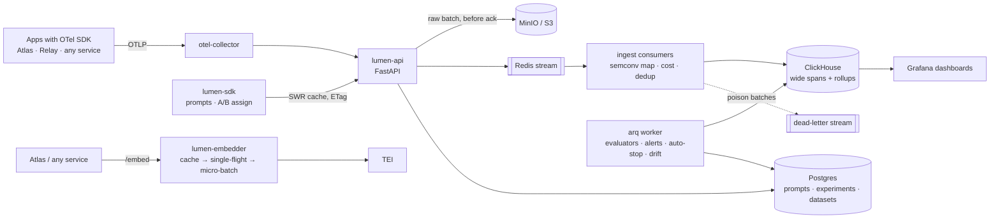

# Lumen: LLMOps control plane

**Know what your LLM features cost, how fast they are, whether they're getting worse, and which
prompt change caused it.** Lumen is a self-hosted, OpenTelemetry-native platform with three
services that share one data layer:

| | What it does |
|---|---|
| **Observability** | OTLP ingest of `gen_ai.*` spans → ClickHouse. Cost attribution (versioned price manifests, cache-aware), latency/TTFT percentiles, sessions, trace waterfalls, online evaluators (PII, refusals, LLM-judge groundedness), alerting (SLO burn rate, cost anomalies, quality drops, prompt-cache collapse, query drift) |
| **Prompt registry + experiments** | Immutable prompt versions, labels with rollback, typed variables, sandboxed rendering, **eval-gated promotion**. A/B tests with deterministic assignment, SRM checks, **always-valid sequential testing**, CUPED, guardrails and auto-stop |
| **Embedding service** | One embedding API for every team: content-hash cache, single-flight, **token-budget micro-batching**, model versioning, re-embedding migrations. TEI- and OpenAI-compatible, so clients need no changes |

Architecture: [docs/architecture.md](docs/architecture.md) · diagrams: [docs/diagrams/lumen.drawio](docs/diagrams/lumen.drawio)
(10 pages: system, ingest path, ClickHouse model, registry/SDK, experiments, evals, alerting, embeddings,
deployment, module map) · decisions: [docs/adr/](docs/adr/)



ASCII version:
```
apps (OTel SDK) ─▶ otel-collector ─▶ lumen-api ─▶ MinIO (raw) ─▶ Redis stream ─▶ ingest ─▶ ClickHouse ─▶ Grafana
                                       │                                                     ▲
lumen-sdk ── prompts (SWR cache) ──────┤ Postgres: registry · experiments · datasets         │
                                       └ arq worker: evals · alerts · auto-stop · drift ─────┘
Atlas / any service ── /embed ─▶ lumen-embedder (cache → single-flight → micro-batch) ─▶ TEI
```

## Quickstart
```bash
cp .env.example .env            # COMPOSE_PROFILES=cpu; add ,observability for collector + Grafana
docker compose up -d --build --wait
make bootstrap                  # → {"project_id": ..., "api_key": "lmn_..."} (shown once)
bash scripts/smoke.sh           # sends an OTLP span and reads it back
```
Point any OTel exporter at `http://localhost:8000/v1/traces` with `Authorization: Bearer lmn_...`, or
at the collector (`:4318`) when the `observability` profile is on. Grafana: http://localhost:3000.

## API overview (OpenAPI at `/docs`)
| Area | Endpoints |
|---|---|
| Ingest | `POST /v1/traces` (OTLP/HTTP protobuf or JSON) · `POST /v1/feedback` |
| Explore | `GET /v1/traces`, `/v1/traces/{id}` (waterfall) · `/v1/sessions` · `/v1/metrics/llm?group_by=route\|model\|tenant\|prompt\|variant` |
| Scores | `POST /v1/scores` (numeric / categorical / boolean; source api/eval/annotation/feedback) |
| Prompts | `POST /v1/prompts/{name}/versions` · `GET /v1/prompts/{name}?label=` (ETag) · `PUT .../labels/{label}` (gated) · `POST .../rollback` · `POST .../versions/{v}/evals` · `POST .../render` |
| Experiments | `POST /v1/experiments` · `POST /v1/experiments/{key}/start\|stop` · `GET .../assign?unit_id=` · `GET .../results` |
| Datasets | `POST /v1/datasets` · `POST .../items` (incl. from traces) · `POST .../runs` |
| Annotation | `POST /v1/annotation-queues` · `.../claim` (SKIP LOCKED) · `POST /v1/annotation-items/{id}/complete` |
| Alerts | `POST/GET /v1/alerts/rules` · `GET /v1/alerts/events` |
| Embeddings | embedder `:8080`: `POST /v1/embed` · `/v1/embeddings` (OpenAI) · `/embed`, `/rerank` (TEI) · `POST /v1/embedding-migrations` (api) |

## SDK
```python
from lumen_sdk import PromptClient
prompts = PromptClient("http://localhost:8000", "lmn_...")
p = await prompts.get("rag-answer", label="production", fallback=[{"role": "system", "content": "..."}])
variant = prompts.assign("answer-prompt-test", unit_id=user_id, variants=[("control", .5), ("short", .5)])
messages = p.render(question=q)   # span auto-tagged with gen_ai.prompt.name/version + experiment variant
```

## Integration with Atlas
* Atlas's gateway/API spans flow in via OTLP (set `ATLAS_OTLP_ENDPOINT` to the collector). Its `atlas.route` and `atlas.cache` attributes are mapped automatically.
* `ATLAS_EMBED_URL=http://embedder:8080`: Atlas's TEI client works unchanged and gains a shared cache and batching.
* Lumen's groundedness judge calls Atlas's gateway route `judge`, and Atlas's prompts can move into the registry.

## Engineering highlights
* **No data loss by design:** the raw batch is in S3 before the ack. The consumer group XACKs after insert. Insert dedup tokens make retries idempotent. A dead-letter stream keeps poison batches replayable.
* **ClickHouse modelled for scale:** wide insert-only spans (no `FINAL`), minute/hour AggregatingMergeTree rollups, bloom filters, TTLs, UTC.
* **Cost you can trust:** disjoint token buckets (no double counting cached tokens), regex price matching with long-context tiers, the price manifest chosen by span time, client cost overrides.
* **Statistics you can trust:** stdlib implementations unit-tested against known values. The A/A simulation is a CI step.

## Status
The code, unit tests, ADRs and diagrams are complete. The full Docker stack has not yet been run end to end, and the benchmark table below stays empty until it has, because no number is estimated. In the meantime, Atlas ships its own self-hosted tracing (Pulse), which has been run end to end.

Related projects: [Atlas](https://github.com/Priteshverma123/atlas-rag-platform) (RAG platform) and [Relay](https://github.com/Priteshverma123/relay-agent-platform) (agent platform).

## Results (fill from `bench/`, never estimate)
| Benchmark | Command | Result |
|---|---|---|
| A/A false-positive rate: fixed horizon peeked vs sequential | `python bench/aa_simulation.py` | _run & paste_ |
| Sustained ingest spans/s · freshness | `python bench/span_load.py --rate 5000` | _run & paste_ |
| Embedding req/s & p95: TEI direct vs micro-batched (0/2/5/10 ms) | `python bench/batching_sweep.py` | _run & paste_ |
| Embedding cache hit rate on Atlas re-ingestion | Grafana "embedding service" | _run & paste_ |

## Development
```bash
uv sync && uv run pytest        # unit tests (stats, semconv, pricing, batcher, registry, alerts, evals)
uv run ruff check . && uv run mypy
make diagrams dashboards         # regenerate draw.io + Grafana JSON from code
```
